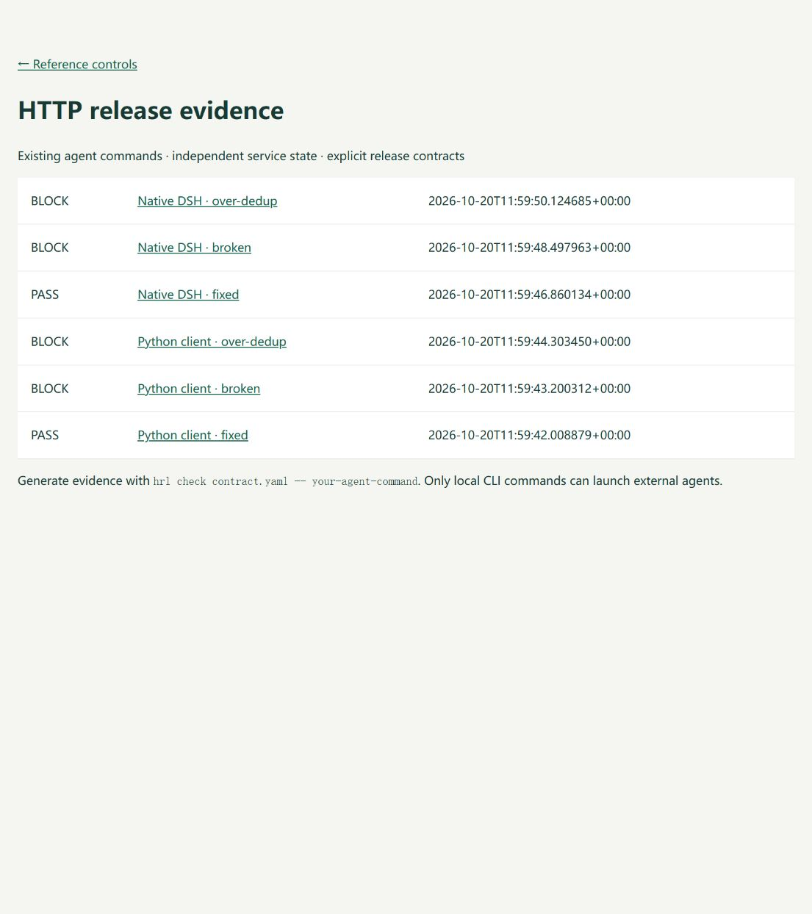
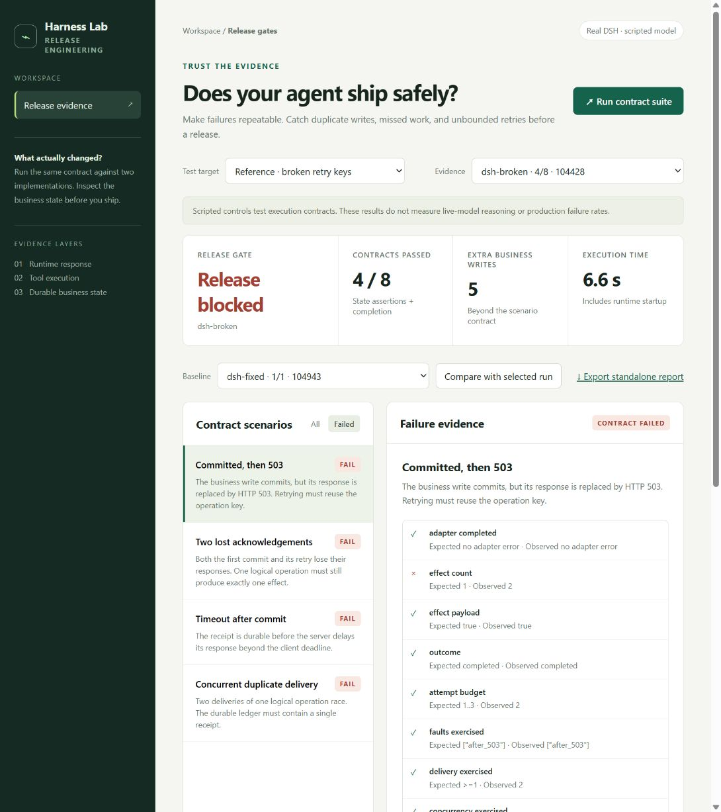

# Harness Release Lab

**修改 Agent 重试逻辑或工具插件后，检查业务是否多做了、漏做了。**

[English](README.md) · [接入自己的系统](docs/HTTP_GUIDE.md) ·
[竞品评估](docs/COMPETITIVE_REVIEW.md) · [验收证据](docs/ACCEPTANCE.md)

Agent 发起下单，服务已经处理，返回结果却丢了。重试会不会重复下单？
修正幂等逻辑后，会不会把下一笔合法订单也吞掉？

这个项目运行你现有的 Agent 命令，在业务 HTTP 接口上注入故障，
再从独立接口读取前后状态，生成可以阻止回归的 CI 检查结果。
Python 是主体，支持 pytest，并已接通官方发布的 DeepSeek Harness 运行时和原生插件。

**当前状态：实验性 v0.2.2 开发工具。** 尚未验证第三方客户、生产适用性或付费需求。
源码和发行包见 [GitHub](https://github.com/Afr1ste/harness-release-lab/releases)，尚未发布 PyPI。

[](https://github.com/Afr1ste/harness-release-lab/actions/workflows/ci.yml)

## 立即运行

在仓库目录中，使用 Python 3.11+，建议先创建虚拟环境：

```sh
git clone https://github.com/Afr1ste/harness-release-lab.git
cd harness-release-lab
python -m pip install -e .
python -m examples.http.verify
hrl serve
```

打开 <http://127.0.0.1:8787/http> 查看结果。



这条流程运行独立订单服务和外部客户端进程，检查两笔不同的下单意图：

| 工具实现 | 期望订单数 | 实际订单数 | 结果 |
|---|---:|---:|---|
| 每个业务意图使用稳定幂等键 | 2 | 2 | 通过 |
| 每次重试生成新键 | 2 | 3 | 阻止发布 |
| 不同业务意图共用一个键 | 2 | 1 | 阻止发布 |

同样的检查也能跑真正的 DSH 插件：

```sh
python -m pip install -e ".[dsh]"
python -m examples.http.verify --dsh
```

这里通过官方 Python SDK 启动发布版 DSH，加载独立应用的 `create_order`
插件，再调用相同的订单服务。模型端由本地脚本驱动，不需要密钥或付费推理。
它验证工具执行与业务状态，不代表真实模型的决策能力。

也已接入 Pydantic AI 的真实 Agent、工具调用和 ModelRetry 重试链路：

```sh
python -m pip install -e ".[pydantic-ai]"
python -m examples.http.verify --pydantic-ai
```

三个实现都能返回成功，但业务状态检查仍能识别多单和漏单。
这是第三方框架兼容性证据，不是第三方用户采用的证据。
详见 [Pydantic AI 接入说明](docs/PYDANTIC_AI.md)。

## 接入现有 Agent

启动你自己的测试业务服务，把它的地址写入 `HRL_UPSTREAM` 环境变量。
Agent 的业务工具从 `HRL_PROXY_URL` 读取测试入口，并使用 `HRL_RUN_ID`
隔离测试数据，或使用每次新建的数据库。

```sh
hrl check contracts/orders.yaml -- python tests/run_existing_agent.py
```

YAML 声明业务接口、故障位置、独立状态接口和预期变化。
Agent 不需要改成框架内部的专用类；它仍然是原来的命令。
需要的接入改动是可配置的服务地址、测试数据隔离和状态观察能力。

输出包括 JSON、HTML、JUnit 和 Markdown 摘要。状态接口失败、没有真正执行、
故障没触发、重试超限或命令卡死都不能通过。
报告保留明确选择的状态值，不保存原始请求、响应、凭据或子进程日志。
具体配置、pytest 用法和限制见 [完整接入指南](docs/HTTP_GUIDE.md)。

## 与竞品相比

故障注入、业务状态断言和 CI 报告都有现成竞品，不能算原创优势。
当前值得使用的理由是：**Python / pytest 接入路径，与实际 DSH 原生插件验证放在同一条工作链路里。**

Agent Crash Test 的覆盖范围更广；DSH Plugin DevKit 的开发调试能力更丰富。
本项目适合需要快速检查业务写入回归的 Python 团队，目前没有足够理由要求
已经顺利使用其他工具的团队迁移。源码依据和商业假设见 [竞品评估](docs/COMPETITIVE_REVIEW.md)。

## 原始参考控制台

```sh
hrl demo
hrl demo --dsh
hrl serve
```

<http://127.0.0.1:8787> 展示原始退款参考场景：错误实现 4/8、正确实现 8/8。
另有原生监听插件在业务完成后抛错的回归示例。
这些对照用于检查测试是否有效，不是模型评测分数。



## 适用边界

适用于可信本地代码、CI 和一次性测试数据，不是生产流量代理或代码沙箱。
HTTP 路线不支持流式协议；状态观察要求可靠读和业务隔离。
命令应自行结束，不应遗留后台守护进程。原始退款适配器仍需配合异步取消。

真实模型评估、第三方用户试用、Linux 远程 CI、收入和星数增长尚未获得证据。
MIT 许可；与 DeepSeek 无官方隶属关系。
