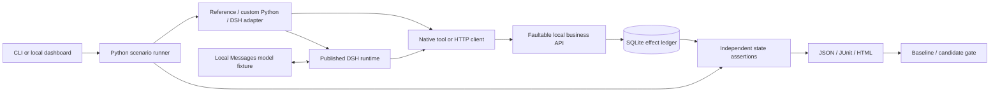

# Architecture and tradeoffs

## v0.2 external HTTP path

```text
existing agent command → fault gateway → application's HTTP service
                             │                       │
                             └── metadata            └── independent before/after state
```

`http_contract.py` validates YAML and JSON Pointers. `http_proxy.py` matches physical
method/path occurrences, injects bounded failures and never labels HTTP 2xx a commit.
`http_runner.py` owns child deadlines, independent observations and reports.
`pytest_plugin.py` exposes the same runner as a fixture.

This path assumes no refund schema, database table or adapter return value. The order
example has an independent service and both an ordinary Python client and a DSH plugin.
The process is trusted, not sandboxed. Admission closes and admitted requests drain
before state observation. This does not prove eventual workflow completion; see
[HTTP limits](HTTP_GUIDE.md).

## Original reference engine

## Runtime path



The runtime integration imports the published Python SDK. It launches the shipped
`sdk-minimal` profile with an explicit per-case home and workspace, then adds the
native Lab tool through a profile patch. No repository source build substitutes
for the shipping runtime.

## Responsibility boundaries

| Component | Responsibility | Does not decide |
|---|---|---|
| Scenario | Operation, fault sequence, expected state and outcome | Agent retry behavior |
| Agent adapter | Actual HTTP/tool execution and observed terminal outcome | Acceptance verdict |
| Business API | Durable writes, idempotency semantics, injected response faults | Whether agent passed |
| Runner | Lifecycle, limits, artifact generation | Model intelligence |
| Checker | Effects, payload, execution, fault consumption, attempt bounds | Whether production is universally safe |
| Dashboard | Start built-in runs and inspect stored evidence | Arbitrary Python import or shell execution |

The scenario passed to an adapter is a deep copy. Accidental adapter edits do not
change the engine's acceptance criteria. Custom adapters remain trusted code and
can access the filesystem; this is not adversarial isolation.

## Ambiguous commit semantics

`World.apply()` opens `BEGIN IMMEDIATE`, assigns an attempt, and atomically inserts
an idempotency-key receipt or returns the existing one. A mismatched payload under
an existing key produces 409. A unique database constraint backs the decision.

`after_503` and `after_timeout` commit the transaction **before** the server returns
an error or delays its response. This preserves the distinction between “the caller
saw a failure” and “the business action did not happen.”

The test business honors idempotency keys. The corrected control reuses one logical
operation key. This is not universal exactly-once delivery: a production service
without idempotency support needs reconciliation or domain-specific compensation.
The demo key uses the order ID because each scenario models one refund intent.
Multiple legitimate partial refunds require an intent ID, not merely the order ID.

Events are transaction-ordered. `response_prepared` records intended server response
metadata, not proof that a client received it. SDK tool feedback supplies the separate
caller-observed status. Events are not a wall-clock distributed trace.

Concurrency uses a barrier before ledger access. Both deliveries must arrive while
the other is pending. SQLite then serializes the commit decisions; the test verifies
atomic state under real overlapping requests.

## Preventing false green results

- Require at least one physical request.
- Count durable effects, not success strings.
- Check exact payload independently of effect count.
- Require the complete fault schedule to be consumed.
- Enforce delivery count and prove concurrency when requested.
- Treat adapter startup/protocol exceptions as failed checks.
- Validate aggregate verdicts when reading saved reports.
- Require the same suite fingerprint and evidence mode for comparisons.
- Keep both broken and corrected controls.

Reports record engine source hash, environment and patch hashes. They are inspectable
local artifacts, not cryptographically signed or tamper-proof attestations.

## Lifecycle and exposure

Each case owns its database, DSH home, temporary business bearer token and loopback
servers. Servers bind an ephemeral socket before starting, so port selection cannot
race another process. The runner closes them before snapshotting final state.
The dashboard binds only to `127.0.0.1`; it rejects unexpected Host/Origin headers
and requires JSON for mutations. It admits one active run.

The DSH SDK has explicit startup, request and shutdown deadlines. Custom Python
adapters must cooperate with asyncio cancellation; synchronous blocking or spawned
external work cannot be forcibly contained by the in-process extension interface.

Keep this tool local. Multi-user hosting needs authentication, authorization,
worker process isolation, quotas, durable job recovery and a different deployment
design. A directory under a fresh home is not an operating-system sandbox.

## What is deliberately not in v0.1

- Live model evaluation and statistics across stochastic runs.
- General OpenAPI/MCP fault proxying or production traffic capture.
- Arbitrary state observers and domain-specific contracts.
- Hard isolation of untrusted adapters/plugins.
- Hosted team accounts, billing, RBAC or audit retention.
- Claims about production cost savings or incident reduction.

The next extension should follow an actual adopter's integration problem. More
fault names alone are not a product strategy.
